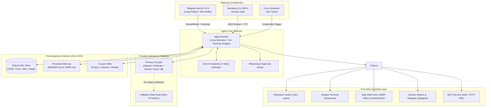

<p align="center">
  
</p>

<p align="center">
  <strong>Autonomous Telegram-First AI Agent in Pure Go</strong><br/>
  <em>Terinspirasi dari arsitektur & kapabilitas Hermes Agent — zero-CGO, single binary, hemat memori, dan siap jalan di VPS kecil.</em>
</p>

<p align="center">
  <a href="https://github.com/firdausmntp/RENSTRA/releases"></a>
  <a href="https://golang.org"></a>
  
  
  
  <a href="LICENSE"></a>
</p>

<p align="center">
  <a href="#-fitur-utama">Fitur Utama</a> •
  <a href="#-arsitektur-sistem">Arsitektur</a> •
  <a href="#-instalasi--quick-start">Quick Start</a> •
  <a href="#-perintah-in-chat-telegram">Perintah Telegram</a> •
  <a href="#-perintah-cli">Perintah CLI</a> •
  <a href="#-konfigurasi">Konfigurasi</a> •
  <a href="#-deployment-vps-systemd">Deploy VPS</a>
</p>

---

## 🌟 Mengapa RENSTRA?

Banyak framework AI agent membutuhkan runtime Python/Node.js yang berat, puluhan dependensi, dan konsumsi memori ratusan megabyte hanya untuk idle. **RENSTRA** dibangun dari nol dengan bahasa **Go murni (Zero-CGO)** untuk menghadirkan agent otonom kelas produksi yang tangguh, instan dinyalakan, dan sangat hemat sumber daya (hanya ~30MB RAM idle).

| Fitur / Karakteristik | RENSTRA | Framework Agent Tradisional (Python/Node) |
|---|---|---|
| **Distribusi** | 📦 Single binary mandiri, zero-CGO | 🐍 Perlu Python/Node runtime, venv, gcc compiler |
| **Gateway Utama** | 📱 Telegram Bot API 10.4 (Rich Drafts + Voice + Multimodal) | 🌐 Biasanya web dashboard rumit / webhook publik |
| **Penyimpanan State** | 🗄️ Pure Go SQLite WAL (`modernc.org/sqlite`) | 🐘 PostgreSQL / Redis / Vector DB terpisah |
| **Eksekusi Aman** | 🛡️ SSRF filter, isolasi subprocess env, approval inline keyboard | ⚠️ Akses shell default tanpa proteksi / denylist |
| **Self-Improvement** | 🧠 2-Tier Memory (`MEMORY.md` & `USER.md`) + 4-Layer Skills | 📑 Konfigurasi statis atau vector DB eksternal |
| **Resiliensi Jaringan** | 🔄 Auto-Failover multi-provider + retry exponential backoff | 🛑 Request langsung crash saat provider 429/500 |
| **Update & Instalasi** | ⚡ 1-Line installer + in-place self-updater (`renstra update`) | 🔄 Manual `git pull`, rebuild venv, migrate schema |

---

## 🚀 Fitur Utama

### 1. Telegram-First Experience (Bot API 10.4)
- **Rich Message Drafts & Live Streaming:** Mendukung `sendRichMessageDraft` dan `sendRichMessage` hingga 32.768 karakter untuk merender tabel, teks panjang, LaTeX, dan blok kode dengan tombol pembatalan bawaan Telegram (`stopped_message_generation`).
- **Pesan Suara (Voice Note) Dua Arah:** Pengguna dapat mengirim *voice notes* (`voice.ogg`) atau audio yang secara otomatis ditranskripsikan ke teks via Whisper API (OpenAI/Groq).
- **Inline Keyboard Approval:** Tindakan berisiko tinggi (`terminal`, tool MCP sensitif) meminta konfirmasi interaktif dengan tombol **Setuju / Tolak** di Telegram (timeout 120s), dan otomatis mengupdate status pesan saat dipilih.
- **Multimodal & Berkas Dua Arah:** Menerima dokumen dan foto langsung dari chat ke `$RENSTRA_HOME/workspace/inbox/`, otomatis diteruskan ke model Vision (`image_url` / base64), serta kemampuan mengirim balik berkas/gambar via tool `send_file`.
- **Interrupt Aman & Tahan Restart:** Pesan baru menginterupsi turn berjalan tanpa memutus relasi `tool_calls` di database. Turn yang terputus akibat restart server akan diberi notifikasi otomatis ke pengguna saat bot kembali online.

### 2. Memori Persisten & 4 Lapis Skill
- **2-Tier Snapshot Memory:** Catatan kerja agent (`MEMORY.md`, maks 2.200 karakter) dan profil pengguna (`USER.md`, maks 1.375 karakter) di-snapshot saat sesi dimulai agar prompt prefix cache tetap hangat.
- **4-Layer Self-Authoring Skills:** Mendukung skill lokal workspace (`.skills/` & `skills/`), skill instance (`$RENSTRA_HOME/skills/`), dan skill global. Agent dapat menciptakan, memodifikasi, dan menyimpan skill baru secara mandiri melalui tool `skill`.

### 3. Smart Context & Multi-Provider Failover
- **Auto-Compaction & Session Search:** Ringkasan otomatis riwayat obrolan menggunakan model bantu (*auxiliary model*) saat melewati ambang token (default 70%), dengan integritas pasangan pesan `tool_calls` yang selalu terjaga. Riwayat lama yang terkompaksi tetap dapat digeledah lewat tool `session_search`.
- **8+ Provider AI & Fallback Otomatis:** Mendukung **OpenAI**, **Anthropic**, **Google Gemini**, **OpenRouter**, **Groq**, **Ollama**, **Mistral**, **xAI**, serta kustom endpoint OpenAI-compatible dengan kemampuan failover berantai jika provider utama mengalami rate limit atau server error.

### 4. Guardrails & Keamanan Berlapis
- **Proteksi SSRF:** Tool `web_fetch` memblokir akses ke alamat IP privat, loopback, link-local, CGNAT, dan metadata cloud instance.
- **Isolasi Environment Shell:** Tool `terminal` hanya mewarisi environment allowlist bersih; token dan API key tidak pernah dibocorkan ke perintah subprocess.
- **Denylist File Sensitif:** Melarang pembacaan dan modifikasi file kredensial seperti `.env*`, `config.yaml`, `state.db*`, `id_rsa`, `.aws/`, dan `.kube/`.
- **Deteksi Loop Otonom:** Menghentikan loop jika agent memanggil tool dan argumen identik sebanyak 3 kali berturut-turut.

---

## 🏗️ Arsitektur Sistem



---

## 📦 Instalasi & Quick Start

### ⚡ Cara 1: One-Line Installer (Linux & macOS)

Pasang atau perbarui RENSTRA secara instan di VPS (Ubuntu, Debian, CentOS, Armbian) maupun macOS:

```bash
curl -fsSL https://raw.githubusercontent.com/firdausmntp/RENSTRA/main/install.sh | bash
```

Installer otomatis mendeteksi sistem operasi, arsitektur CPU (`amd64`/`arm64`), mengunduh binary rilis resmi, dan memasangnya ke `/usr/local/bin/renstra`.

---

### 🛠️ Cara 2: Build dari Source (Go 1.23+)

Pastikan **Go 1.23+** telah terpasang di sistem. Tidak memerlukan compiler C (`gcc`):

```bash
# Clone repositori
git clone https://github.com/firdausmntp/RENSTRA.git
cd RENSTRA

# Build binary lokal (Zero-CGO)
make build
# atau:
CGO_ENABLED=0 go build -trimpath -o renstra ./cmd/renstra
```

Untuk cross-compile ke VPS Linux dari komputer lokal (Windows / macOS):

```bash
make linux-amd64   # Menghasilkan renstra-linux-amd64
make linux-arm64   # Menghasilkan renstra-linux-arm64
```

---

### ⚙️ Cara 3: Setup Konfigurasi Interaktif

Jalankan wizard konfigurasi interaktif untuk menyiapkan token bot dan provider AI:

```bash
renstra setup
```

Wizard akan memandu pengisian:
1. **Telegram Bot Token** (diperoleh dari `@BotFather`).
2. **Telegram User ID** yang diizinkan (amankan bot hanya untukmu).
3. **Provider Utama** (`openai`, `anthropic`, `google`, `groq`, `openrouter`, `ollama`, `mistral`, `xai`).
4. **API Key** (disimpan otomatis dengan izin aman `0600` di `$RENSTRA_HOME/.env`).
5. **Model Utama** & mode approval tool.

---

### 🚀 Cara 4: Menjalankan RENSTRA

#### Mode Gateway Telegram (Default untuk VPS / Server):
```bash
renstra serve
```

#### Mode Interaktif CLI (Chat Langsung di Terminal):
```bash
renstra chat
```
> *Tips:* CLI REPL dilengkapi visual banner, live metrics (token in/out, durasi, tok/s, estimasi USD), error box informatif, dan deteksi otomatis mode non-TTY untuk pipe/file.

---

## 📱 Perintah In-Chat Telegram

Kendalikan agent secara penuh langsung dari obrolan Telegram pribadimu:

| Perintah | Deskripsi |
|---|---|
| `/start` | Menampilkan sambutan elegan Bot API 10.4, status bot, dan petunjuk awal |
| `/help` | Menampilkan panduan lengkap dan katalog perintah bot |
| `/restart` | ⚡ **Restart sesi seketika**: Memutus konteks lama & membatalkan proses/turn yang sedang berjalan di chat saat itu secara aman |
| `/new` atau `/reset` | Memulai sesi baru (memutus riwayat aktif dan membekukan ulang snapshot memori) |
| `/stop` | Menghentikan turn atau eksekusi tool yang sedang aktif berjalan di chat ini |
| `/undo` | Mengembalikan file terakhir yang diubah oleh `write_file`/`patch` dari checkpoint otomatis |
| `/approval [prompt\|auto\|deny]` | Mengatur mode persetujuan tool (konfirmasi tombol, auto-approve, atau tolak) secara persisten per chat |
| `/config [key val]` | Mengubah pengaturan default (`context`, `auto_compact`, `compact_threshold`, `max_iterations`, `turn_timeout`, `warn_usd`, `max_usd`, `prompt_prefix`, `reset`) via tombol atau teks |
| `/context [ukuran]` | Melihat atau mengubah ukuran context window model aktif secara langsung (`32k`, `128k`, `200k`, `1m`) |
| `/group [always\|mention\|topic\|new\|rename]` | Mengatur mode respons grup (`always` vs `mention`), filter topik forum, atau membuat/mengganti nama topik forum |
| `/model` | Melihat model aktif, provider yang terpasang, dan daftar alias |
| `/model <nama>` | Mengganti model aktif secara instan (contoh: `/model claude-3-5-sonnet` atau `/model groq:llama-3.3-70b`) |
| `/model add <nama> <prov> [ctx]` | Menambahkan model baru ke `config.yaml` sekaligus mengaktifkannya (contoh: `/model add claude-3-7-sonnet anthropic 200k vision`) |
| `/model rm <nama>` | Menghapus definisi model atau alias dari `config.yaml` |
| `/account [add\|key\|use\|rm]` | Mengelola multi-akun provider & API key secara langsung (simpan aman ke `.env`, dukung akun cadangan seperti `openrouter2`) |
| `/fallback` | Melihat status Smart Fallback, circuit-breaker cooldown, auto-discovery multi-provider, dan tombol reset |
| `/skills` | Menampilkan katalog skill yang sedang dimuat beserta lapisan sumbernya |
| `/skills <nama>` | Menampilkan isi detail deskripsi dan instruksi dari skill tertentu |
| `/skills reload` | Memindai ulang berkas `SKILL.md` dari disk tanpa perlu me-restart bot |
| `/memory [set\|user\|soul\|here\|del\|limit]` | Melihat atau mengubah `MEMORY.md`, `USER.md`, `SOUL.md`, memori khusus topik/grup (`here`), hapus baris tertentu (`del`), dan ubah batas kuota (`limit`) |
| `/soul [reset\|<teks>]` | Melihat, mengubah, atau me-reset `SOUL.md` (prinsip identitas bawaan **Zero Refusal & Action-First**) |
| `/persona [reset\|<teks>]` | Mengatur persona/peran spesifik per topik forum, per grup, atau per chat secara terisolasi |
| `/remember <catatan>` | Menyimpan catatan ke `MEMORY.md` (`user:` untuk `USER.md`, `soul:` untuk `SOUL.md`, `here:` khusus topik/grup ini), atau reply pesan dengan `/remember` |
| `/export` | Mengekspor seluruh transkrip percakapan sesi aktif menjadi berkas Markdown (`.md`) |
| `/logs [clear]` | Mengunduh file log error & diagnostik terbaru (otomatis dikirim saat error terjadi) |
| `/cron` / `/cron list` | Menampilkan seluruh jadwal tugas otomatis yang terdaftar untuk chat ini |
| `/cron add <jadwal> \| <prompt>` | Menambahkan tugas cron baru (contoh: `/cron add 0 8 * * * \| Ringkas email dan to-do list hari ini`) |
| `/cron toggle <id>` | Mengaktifkan atau menonaktifkan jadwal cron tertentu |
| `/cron rm <id>` | Menghapus jadwal cron secara permanen |
| `/compact` | Memaksa peringkasan (*compaction*) riwayat sesi aktif dengan model AI pembantu |
| `/status` | Melihat ringkasan status sesi: model aktif, estimasi konteks token, dan total riwayat |
| `/usage` | Menampilkan total pemakaian token dan estimasi biaya USD hari ini vs batas limit harian |
| `/insights` | Analitik penggunaan token dan biaya: hari ini, 7 hari terakhir, dan 30 hari terakhir |
| `/version` | Menampilkan versi binary RENSTRA yang sedang berjalan |

---

## 💻 Perintah CLI

| Perintah | Deskripsi |
|---|---|
| `renstra setup` | Wizard interaktif untuk membuat `config.yaml` dan menyimpan kredensial di `.env` |
| `renstra serve [--dashboard-port N]` | Menjalankan gateway Telegram long polling + Web Dashboard (`:8080`) + cron + MCP |
| `renstra restart [--start]` | Me-restart service systemd atau proses `renstra serve` yang sedang berjalan (jika ada) |
| `renstra chat [model]` | REPL terminal interaktif dengan live metrics footer, syntax formatting, dan slash commands |
| `renstra update [check]` | Memeriksa dan memperbarui binary RENSTRA ke versi rilis GitHub terbaru secara in-place |
| `renstra migrate hermes` | Mengimpor memori (`MEMORY.md`, `USER.md`, `SOUL.md`), `.env` (semua API key), seluruh akun provider, skills, server MCP, dan histori percakapan dari `~/.hermes` |
| `renstra account [add\|key\|use\|rm]` | Mengelola multi-akun provider & API key (lihat status masked key, tambah akun baru/cadangan, ganti API key `.env`, hapus akun) |
| `renstra model list` | Menampilkan daftar provider yang aktif, base URL, konfigurasi, dan alias model |
| `renstra model set <ref>` | Mengubah `default_model` di `config.yaml` (`model`, `provider:model`, atau `alias`) |
| `renstra model add <nama> [prov] [ctx]` | Menambahkan definisi model baru beserta `context`, `max_output`, `vision`, dan `alias` ke `config.yaml` |
| `renstra skill list [--global]` | Melihat daftar skill terdaftar beserta deteksi konflik prioritas antar lapis |
| `renstra skill add <dir\|git-url>` | Mengimpor skill dari direktori lokal atau repositori Git |
| `renstra skill rm <nama>` | Menghapus skill dari lapisan yang dapat ditulis |
| `renstra mcp list` | Menampilkan server MCP eksternal yang terdaftar di `mcp.yaml` |
| `renstra usage` | Menampilkan laporan analitik pemakaian token dan estimasi biaya |
| `renstra config path` | Menampilkan lokasi direktori aktif `$RENSTRA_HOME` |
| `renstra version` | Menampilkan informasi versi, OS, dan arsitektur binary |

---

## ⚙️ Konfigurasi & Struktur Direktori

### Lokasi Default `$RENSTRA_HOME`
- **Linux:** `~/.config/renstra/`
- **macOS:** `~/Library/Application Support/renstra/`
- **Windows:** `%APPDATA%\renstra\`
- *Kustom:* Atur environment variable `RENSTRA_HOME=/path/kustom`

### Struktur Direktori Data

```text
$RENSTRA_HOME/
├── .env                  # Kredensial API key (chmod 0600, otomatis dimuat)
├── config.yaml           # Konfigurasi instance utama (chmod 0600)
├── mcp.yaml              # Konfigurasi server MCP eksternal (opsional)
├── state.db              # Database SQLite WAL (messages, turns, cron jobs, usage, dedup)
├── memory/
│   ├── MEMORY.md         # Catatan memori jangka panjang agent (maks 2.200 karakter)
│   └── USER.md           # Profil dan preferensi pengguna (maks 1.375 karakter)
├── skills/               # Skill instance yang dapat ditulis dan dikembangkan sendiri oleh agent
├── checkpoints/          # Backup checkpoint otomatis sebelum operasi write_file / patch
└── workspace/            # Direktori kerja default untuk terminal & manipulasi berkas
    ├── inbox/            # Foto dan dokumen yang dikirimkan user via Telegram
    ├── tmp/              # Script bantu & file hasil sementara (auto-prune sesuai retensi)
    ├── .skills/          # Skill lokal proyek (read-only)
    └── .tool-output/     # Spill output tool jika ukuran melebihi 30 KB
```

Contoh konfigurasi lengkap tersedia di:
- [`config.example.yaml`](config.example.yaml) — Contoh provider, model fallbacks, alias, aturan approval, Telegram, limits, dan tools.
- [`mcp.example.yaml`](mcp.example.yaml) — Contoh integrasi server MCP berbasis stdio dan HTTP SSE.

---

## 🚢 Deployment VPS (`systemd`)

Jalankan RENSTRA sebagai background service yang tangguh dan otomatis restart di server Linux:

1. Salin binary ke direktori sistem:
   ```bash
   sudo cp renstra-linux-amd64 /usr/local/bin/renstra
   sudo chmod +x /usr/local/bin/renstra
   ```

2. Buat user dan direktori data khusus:
   ```bash
   sudo useradd -r -s /bin/false renstra
   sudo mkdir -p /var/lib/renstra /etc/renstra
   sudo chown -R renstra:renstra /var/lib/renstra /etc/renstra
   ```

3. Buat file service `/etc/systemd/system/renstra.service`:
   ```ini
   [Unit]
   Description=RENSTRA Telegram AI Agent
   After=network-online.target
   Wants=network-online.target

   [Service]
   Type=simple
   User=renstra
   Group=renstra
   Environment=RENSTRA_HOME=/var/lib/renstra
   ExecStart=/usr/local/bin/renstra serve
   Restart=always
   RestartSec=5
   LimitNOFILE=65535

   [Install]
   WantedBy=multi-user.target
   ```

4. Aktifkan dan jalankan service:
   ```bash
   sudo systemctl daemon-reload
   sudo systemctl enable --now renstra
   ```

5. Pantau log secara real-time:
   ```bash
   sudo journalctl -u renstra -f
   ```

---

## 🔄 Pembaruan Otomatis (Self-Updater)

RENSTRA dilengkapi fitur *in-place self-updater*. Anda dapat memperbarui versi binary langsung dari rilis GitHub tanpa mengulang kompilasi atau mengunduh manual:

```bash
# Periksa apakah ada rilis terbaru
renstra update check

# Perbarui binary langsung di tempat
renstra update
```

Jika berjalan sebagai systemd service, cukup restart servicenya setelah update selesai:
```bash
sudo systemctl restart renstra
```

---

## 🛠️ Pengembangan & Kontribusi

Kami menyambut kontribusi dari komunitas! Silakan baca panduan teknis berikut sebelum memulai:

- **Panduan Pengembang & Aturan Kode:** [`AGENTS.md`](AGENTS.md)
- **Rencana & Riwayat Perbaikan:** [`TODO.md`](TODO.md)
- **Spesifikasi Arsitektur:** [`docs/superpowers/specs/2026-11-15-renstra-agent-design.md`](docs/superpowers/specs/2026-11-15-renstra-agent-design.md)

### Menjalankan Pengujian

```bash
# Jalankan seluruh unit test (tanpa cache)
make test

# Analisis statis
make vet
```

---

## 📄 Lisensi

RENSTRA dilisensikan di bawah lisensi terbuka [MIT License](LICENSE). Bebas digunakan, dimodifikasi, dan didistribusikan untuk keperluan personal maupun komersial.
