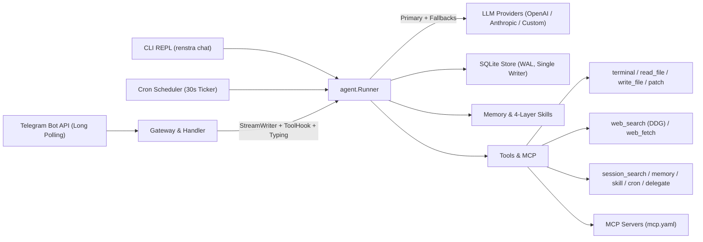

<p align="center">
  
</p>

<p align="center">
  <strong>Self-Hosted Telegram-First AI Agent in Pure Go</strong><br/>
  Terinspirasi dari perilaku inti Hermes Agent — ringan, satu binary, tanpa CGO, siap jalan di VPS kecil.
</p>

<p align="center">
  <a href="https://github.com/firdausmntp/RENSTRA"></a>
  
  
  
</p>

<p align="center">
  <a href="#fitur-utama">Fitur</a> •
  <a href="#arsitektur">Arsitektur</a> •
  <a href="#instalasi--quick-start">Quick Start</a> •
  <a href="#perintah-in-chat-telegram">Perintah Telegram</a> •
  <a href="#konfigurasi">Konfigurasi</a> •
  <a href="#deployment-vps-systemd">Deploy VPS</a>
</p>

---

**RENSTRA** adalah autonomous AI agent self-hosted berbahasa Go yang dikendalikan langsung lewat **Telegram** (dan REPL terminal sebagai fallback). Dibangun dengan filosofi *single binary, zero-CGO* (`modernc.org/sqlite`), RENSTRA menghadirkan fitur penting seperti *persistent memory*, *4-layer self-authoring skills*, *auto-compaction*, *multi-provider failover*, *cron scheduler*, *subagent delegation*, dan integrasi *MCP* tanpa overhead runtime Python/Node di inti agent.

---

## Fitur Utama

### Telegram-First Experience
- **Live Streaming & Status Tool:** Balasan LLM mengalir real-time melalui edit pesan ter-throttle (`StreamWriter`) disertai status tool yang sedang berjalan (`⏳ Menjalankan ...`).
- **Indikator Typing Otomatis:** Mengirim `sendChatAction: typing` secara berkala selama agent berpikir atau mengeksekusi perintah.
- **Approval Inline Keyboard:** Perintah berisiko (`terminal`, tool MCP) mengirim tombol **Setuju / Tolak** di Telegram (timeout 120 detik), lalu otomatis mengedit pesan menjadi `✅ Disetujui` atau `❌ Ditolak` saat keputusan dipilih.
- **Penerimaan Dokumen & Foto:** File dan foto (beserta `caption`) otomatis diunduh ke `$RENSTRA_HOME/workspace/inbox/` dan diteruskan ke agent.
- **Interrupt & Anti-Dobel Tahan Restart:** Pesan baru di chat yang sibuk menginterupsi turn berjalan secara aman tanpa memutus pasangan `tool_calls` di SQLite. Dedup `updates_seen` mencegah balasan ganda setelah restart, dan turn yang terputus akibat restart diberi notifikasi otomatis.

### Self-Improving Memory & 4-Layer Skills
- **Persistent Memory (`MEMORY.md` & `USER.md`):** Catatan kerja agent (maks 2.200 karakter) dan profil pengguna (maks 1.375 karakter) di-snapshot saat sesi dimulai agar *prompt prefix cache* tetap hangat, dengan pengingat berkala setiap 12 pesan user.
- **4-Layer Skills (`SKILL.md`):** Mendukung skill lokal proyek (`.skills/` dan `skills/` di workspace), skill instance (`$RENSTRA_HOME/skills/`, writable oleh agent), dan skill global. Agent dapat menyimpan prosedur baru lewat tool `skill` (`action=save`).

### Smart Context, Pencarian & Keamanan
- **Auto-Compaction & `session_search`:** Saat pemakaian token melewati ambang konteks model (default 70%), percakapan lama diringkas memakai `aux_model` sambil menjaga grup `assistant(tool_calls)` + `tool` tetap utuh. Riwayat lama tetap dapat dicari kembali lewat `session_search`.
- **Multi-Provider & Auto-Failover:** Mendukung OpenAI, Anthropic, dan endpoint OpenAI-compatible kustom (termasuk proxy & header kustom), lengkap dengan alias model dan rantai `fallbacks`.
- **Guardrails & Kontrol Biaya:**
  - Aturan approval deklaratif (`mode: prompt | auto | deny`, `always_allowed`, `always_denied`).
  - Deteksi loop otomatis jika tool dan argumen identik dipanggil 3× berturut-turut.
  - Batas timeout per turn, pelaporan biaya/token (`/usage`, `/insights`), peringatan `warn_daily_usd`, dan hard cap opsional `max_daily_usd` / `max_daily_tokens`.
  - Konten luar (`web_fetch`, `web_search`, `mcp`) ditandai `[untrusted]`; subprocess `terminal` hanya mewarisi environment allowlist tanpa membocorkan API key.

---

## Arsitektur



---

## Instalasi & Quick Start

### 1. Clone & Build dari Source

Prasyarat: **Go 1.23+** (tanpa perlu `gcc` / CGO).

```bash
git clone https://github.com/firdausmntp/RENSTRA.git
cd RENSTRA

# Build binary lokal
make build
# atau langsung:
CGO_ENABLED=0 go build -o renstra ./cmd/renstra
```

Cross-compile dari mesin lokal untuk VPS Linux:

```bash
make linux-amd64   # menghasilkan renstra-linux-amd64
make linux-arm64   # menghasilkan renstra-linux-arm64
```

### 2. Setup Konfigurasi Awal

```bash
./renstra setup
```

Wizard interaktif akan menanyakan Token Bot Telegram, provider (`openai` / `anthropic`), base URL, nama environment variable API key, model default, Telegram User ID yang diizinkan, dan mode approval, lalu menulis `config.yaml` (izin `0600`). Alternatifnya, salin [`config.example.yaml`](config.example.yaml).

### 3. Set API Key & Jalankan Gateway Telegram

```bash
export OPENAI_API_KEY="sk-..."
# atau jika memakai Anthropic:
# export ANTHROPIC_API_KEY="sk-ant-..."

./renstra serve
```

> Ingin mencoba langsung di terminal tanpa Telegram? Jalankan `./renstra chat`.

---

## Perintah In-Chat Telegram

| Perintah | Fungsi |
|---|---|
| `/help` atau `/start` | Menampilkan daftar perintah yang tersedia |
| `/new` atau `/reset` | Memulai sesi baru (memutus riwayat aktif & freeze ulang memori) |
| `/stop` | Menghentikan turn/tugas yang sedang berjalan di chat ini |
| `/model` | Melihat model aktif, daftar provider terkonfigurasi, dan alias |
| `/model <nama>` | Mengganti model/provider aktif secara langsung (mendukung alias & `provider:model`) |
| `/skills` | Menampilkan daftar skill yang sedang dimuat |
| `/skills reload` | Memindai ulang direktori skill dari disk |
| `/memory` | Melihat isi `MEMORY.md` & `USER.md` beserta pemakaian karakter |
| `/cron` / `/cron list` | Menampilkan daftar jadwal cron untuk chat ini |
| `/cron add <jadwal> \| <prompt>` | Menambah jadwal cron baru (contoh: `/cron add 0 9 * * * \| ringkas berita`) |
| `/cron toggle <id>` | Mengaktifkan/menonaktifkan jadwal cron |
| `/cron rm <id>` | Menghapus jadwal cron |
| `/usage` | Melihat jumlah token & estimasi biaya hari ini beserta batas kuota |
| `/insights` | Ringkasan pemakaian hari ini, 7 hari terakhir, dan 30 hari terakhir |
| `/compact` | Memaksa ringkasan/kompaksi riwayat chat saat ini |

---

## Perintah CLI

| Perintah | Deskripsi |
|---|---|
| `renstra setup` | Wizard interaktif untuk membuat `config.yaml` |
| `renstra serve` | Menjalankan gateway Telegram long polling + cron scheduler + MCP |
| `renstra chat [model]` | Sesi chat interaktif di terminal (REPL) |
| `renstra model list` | Daftar provider aktif, stub, konfigurasi, dan alias |
| `renstra skill list [--global]` | Melihat skill terdaftar beserta info konflik antar lapis |
| `renstra skill add <name> <desc> <body> [--global]` | Menambahkan skill baru |
| `renstra skill rm <name> [--global]` | Menghapus skill dari lapis writable |
| `renstra mcp list` | Menampilkan server MCP yang terdaftar di `mcp.yaml` |
| `renstra usage` | Laporan pemakaian token & estimasi biaya (hari ini & 30 hari) |
| `renstra config path` | Menampilkan direktori aktif `$RENSTRA_HOME` |

---

## Konfigurasi

Lokasi default `$RENSTRA_HOME`:
- **Linux:** `~/.config/renstra/`
- **macOS:** `~/Library/Application Support/renstra/`
- **Windows:** `%APPDATA%\renstra\`
- **Kustom:** set environment variable `RENSTRA_HOME=/path/kustom`

Template siap pakai tersedia di repositori:
- [`config.example.yaml`](config.example.yaml) — Konfigurasi provider, fallback, alias, approval rules, Telegram, agent, tools, dan limits.
- [`mcp.example.yaml`](mcp.example.yaml) — Konfigurasi server MCP eksternal (per instance atau `<UserConfigDir>/renstra/global/mcp.yaml`).

---

## Struktur Direktori Data (`$RENSTRA_HOME`)

```text
$RENSTRA_HOME/
  config.yaml           # Konfigurasi instance (0600)
  mcp.yaml              # Daftar server MCP milik instance (opsional)
  state.db              # SQLite database (WAL) untuk chat, turns, jobs, usage, dedup
  memory/
    MEMORY.md           # Catatan kerja jangka panjang agent (maks 2.200 char)
    USER.md             # Profil dan preferensi user (maks 1.375 char)
  skills/               # Skill milik instance (dapat ditulis agent lewat tool `skill`)
  workspace/            # Working directory default untuk terminal & file tools
    .skills/            # Skill lokal proyek (read-only)
    skills/             # Skill lokal proyek (read-only)
    inbox/              # Dokumen dan foto kiriman user dari Telegram
    .tool-output/       # Spill output tool > 30 KB
```

---

## Deployment VPS (`systemd`)

Salin binary hasil `make linux-amd64` ke `/usr/local/bin/renstra`, lalu buat `/etc/systemd/system/renstra.service`:

```ini
[Unit]
Description=RENSTRA Telegram AI Agent
After=network-online.target
Wants=network-online.target

[Service]
Type=simple
User=renstra
Environment=RENSTRA_HOME=/var/lib/renstra
EnvironmentFile=/etc/renstra/env
ExecStart=/usr/local/bin/renstra serve
Restart=always
RestartSec=5

[Install]
WantedBy=multi-user.target
```

```bash
sudo systemctl daemon-reload
sudo systemctl enable --now renstra
sudo journalctl -u renstra -f
```

---

## Pengembangan & Kontribusi

- Panduan arsitektur, dependency graph, dan invarian kode: [`AGENTS.md`](AGENTS.md)
- Spesifikasi desain: [`docs/superpowers/specs/2026-11-15-renstra-agent-design.md`](docs/superpowers/specs/2026-11-15-renstra-agent-design.md)
- Roadmap v1.1 & v1.2: [`docs/superpowers/plans/2026-11-15-renstra-agent-roadmap.md`](docs/superpowers/plans/2026-11-15-renstra-agent-roadmap.md)

```bash
make test   # go test -count=1 ./...
make vet    # go vet ./...
```
