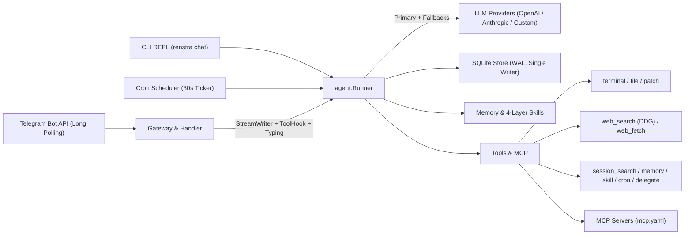

# RENSTRA

**Autonomous Self-Hosted AI Agent in Pure Go — Hermes-Inspired, Telegram-First.**

RENSTRA adalah AI agent pribadi yang ringan, berjalan sebagai **satu binary Go tanpa CGO** (`CGO_ENABLED=0`), dirancang untuk VPS murah maupun mesin lokal, dan dikendalikan langsung dari **Telegram** (atau REPL terminal). RENSTRA mengadopsi perilaku inti Hermes Agent — *persistent memory*, *self-authoring skills*, *auto-compaction*, *multi-provider failover*, *cron scheduler*, *subagent delegation*, dan *MCP plugins* — tanpa beban runtime yang berat.

---

## Fitur Utama

### Telegram-First Experience
- **Live Streaming & Status Tool:** Balasan LLM mengalir real-time melalui edit pesan ter-throttle (`StreamWriter`) dan menampilkan progres tool yang sedang dieksekusi (`⏳ Menjalankan ...`).
- **Indikator Typing Otomatis:** Mengirim `sendChatAction: typing` secara berkala selama agent berpikir atau mengeksekusi perintah.
- **Approval Inline Keyboard:** Perintah berisiko (`terminal`, tool MCP) mengirim tombol **Setuju / Tolak** langsung di chat Telegram dengan timeout 120 detik, lalu mengedit pesan menjadi `✅ Disetujui` / `❌ Ditolak` begitu keputusan dipilih.
- **Penerimaan Dokumen & Foto:** File dan foto (beserta `caption`) yang dikirim ke bot otomatis diunduh ke `$RENSTRA_HOME/workspace/inbox/` dan diteruskan ke agent.
- **Interrupt & Anti-Dobel Tahan Restart:** Pesan baru di chat yang sibuk membatalkan turn lama secara aman tanpa merusak pasangan tool-call di SQLite; `updates_seen` mencegah balasan ganda setelah proses restart; turn yang terputus akibat restart diberi notifikasi otomatis.

### Self-Improving Memory & 4-Layer Skills
- **Persistent Memory (`MEMORY.md` & `USER.md`):** Catatan kerja agent (maks 2.200 karakter) dan profil pengguna (maks 1.375 karakter) di-snapshot saat sesi dimulai agar *prompt prefix cache* tetap hangat, dengan pengingat berkala tiap 12 pesan user.
- **4-Layer Skills (`SKILL.md`):** Mendukung skill lokal proyek (`.skills/` dan `skills/` di workspace), skill milik instance (`$RENSTRA_HOME/skills/`, writable oleh agent), dan skill global. Agent dapat menyimpan prosedur baru lewat tool `skill` (`action=save`).

### Smart Context, Pencarian & Keamanan
- **Auto-Compaction & `session_search`:** Saat pemakaian token mendekati ambang konteks model (default 70%), percakapan lama diringkas memakai `aux_model` sambil mempertahankan grup `assistant(tool_calls)` + hasil `tool` utuh. Riwayat lama tetap tersimpan di SQLite dan dapat dicari kembali dengan `session_search`.
- **Multi-Provider & Auto-Failover:** Mendukung OpenAI, Anthropic, dan endpoint OpenAI-compatible kustom (termasuk proxy & header kustom), lengkap dengan alias model dan rantai `fallbacks`.
- **Guardrails & Kontrol Biaya:**
  - Aturan approval deklaratif (`mode: prompt | auto | deny`, `always_allowed`, `always_denied`).
  - Deteksi loop otomatis jika tool & argumen identik dipanggil 3× berturut-turut.
  - Batas timeout per turn, pelaporan biaya/token harian & 30 hari (`/usage`, `/insights`), peringatan `warn_daily_usd`, dan hard cap opsional `max_daily_usd` / `max_daily_tokens`.
  - Konten eksternal (`web_fetch`, `web_search`, `mcp`) ditandai `[untrusted]`; subprocess `terminal` hanya mewarisi environment allowlist tanpa membocorkan API key.

---

## Arsitektur



---

## Instalasi & Quick Start

### 1. Build dari Source

Prasyarat: **Go 1.23+** (tidak perlu `gcc` / CGO).

```bash
# Clone repositori lalu masuk ke folder proyek
go build -o renstra ./cmd/renstra
```

Cross-compile dari mesin lokal untuk VPS Linux:

```bash
# Linux amd64
CGO_ENABLED=0 GOOS=linux GOARCH=amd64 go build -o renstra-linux-amd64 ./cmd/renstra

# Linux arm64
CGO_ENABLED=0 GOOS=linux GOARCH=arm64 go build -o renstra-linux-arm64 ./cmd/renstra
```

### 2. Setup Konfigurasi Awal

```bash
./renstra setup
```

Wizard interaktif akan menanyakan Token Bot Telegram, provider (`openai` / `anthropic`), base URL, nama environment variable API key, model default, Telegram User ID yang diizinkan, dan mode approval, lalu menulis `config.yaml` (izin `0600`).

### 3. Set API Key & Jalankan Gateway Telegram

```bash
export OPENAI_API_KEY="sk-..."
# atau jika memakai Anthropic:
# export ANTHROPIC_API_KEY="sk-ant-..."

./renstra serve
```

> Untuk mencoba langsung lewat terminal tanpa Telegram: `./renstra chat`

---

## Perintah In-Chat Telegram

| Perintah | Fungsi |
|---|---|
| `/help` atau `/start` | Menampilkan daftar perintah yang tersedia |
| `/new` atau `/reset` | Memulai sesi baru (memutus riwayat aktif & freeze ulang memori) |
| `/stop` | Menghentikan turn/tugas yang sedang berjalan di chat ini |
| `/model` | Melihat model aktif, daftar provider terkonfigurasi, dan alias |
| `/model <nama>` | Mengganti model/provider aktif secara langsung (mendukung alias & `provider:model`) |
| `/skills` | Menampilkan daftar skill yang sedang dimuat |
| `/skills reload` | Memindai ulang direktori skill dari disk |
| `/memory` | Melihat isi `MEMORY.md` & `USER.md` beserta pemakaian karakter |
| `/cron` / `/cron list` | Menampilkan daftar jadwal cron untuk chat ini |
| `/cron add <jadwal> \| <prompt>` | Menambah jadwal cron baru (contoh: `/cron add 0 9 * * * \| ringkas berita`) |
| `/cron toggle <id>` | Mengaktifkan/menonaktifkan jadwal cron |
| `/cron rm <id>` | Menghapus jadwal cron |
| `/usage` | Melihat jumlah token & estimasi biaya hari ini beserta batas kuota |
| `/insights` | Ringkasan pemakaian hari ini, 7 hari terakhir, dan 30 hari terakhir |
| `/compact` | Memaksa ringkasan/kompaksi riwayat chat saat ini |

---

## Perintah CLI

| Perintah | Deskripsi |
|---|---|
| `renstra setup` | Wizard interaktif untuk membuat `config.yaml` |
| `renstra serve` | Menjalankan gateway Telegram long polling + cron scheduler + MCP |
| `renstra chat [model]` | Sesi chat interaktif di terminal (REPL) |
| `renstra model list` | Daftar provider aktif, stub, konfigurasi, dan alias |
| `renstra skill list [--global]` | Melihat skill terdaftar beserta info konflik antar lapis |
| `renstra skill add <name> <desc> <body> [--global]` | Menambahkan skill baru |
| `renstra skill rm <name> [--global]` | Menghapus skill dari lapis writable |
| `renstra mcp list` | Menampilkan server MCP yang terdaftar di `mcp.yaml` |
| `renstra usage` | Laporan pemakaian token & estimasi biaya (hari ini & 30 hari) |
| `renstra config path` | Menampilkan direktori aktif `$RENSTRA_HOME` |

---

## Contoh Konfigurasi

### `config.yaml`

Lokasi default:
- Linux: `~/.config/renstra/config.yaml`
- macOS: `~/Library/Application Support/renstra/config.yaml`
- Windows: `%APPDATA%\renstra\config.yaml`
- Kustom: set environment variable `RENSTRA_HOME=/path/kustom`

```yaml
default_model: "utama:gpt-4o-mini"
fallbacks:
  - "cadangan:claude-sonnet-4-5"

providers:
  utama:
    kind: "openai"                      # openai | anthropic | custom
    base_url: "https://api.openai.com/v1"
    api_key_env: "OPENAI_API_KEY"
    default_model: "gpt-4o-mini"
    timeout: 120s
    models:
      gpt-4o-mini:
        context: 128000
        max_output: 4096
        price_in: 0.15
        price_out: 0.60
  cadangan:
    kind: "anthropic"
    base_url: "https://api.anthropic.com"
    api_key_env: "ANTHROPIC_API_KEY"
    default_model: "claude-sonnet-4-5"
    models:
      claude-sonnet-4-5:
        context: 200000
        max_output: 8192
        price_in: 3.00
        price_out: 15.00

aliases:
  cepat: "utama:gpt-4o-mini"
  sonnet: "cadangan:claude-sonnet-4-5"

approval:
  mode: "prompt"                        # prompt | auto | deny
  timeout: 120s
  always_allowed:
    - "terminal:git status"
    - "terminal:ls"
  always_denied:
    - "terminal:rm -rf"

telegram:
  token: "123456:ABC-DEF..."
  allowed_users:
    - 123456789
  poll_timeout: 30s

agent:
  system_prompt_prefix: "kamu adalah asisten teknis yang ringkas dan akurat"
  max_iterations: 40
  max_turn_timeout: 15m
  aux_model: "gpt-4o-mini"
  auto_compact: true
  compact_threshold: 0.7

tools:
  terminal: true
  read_file: true
  write_file: true
  patch: true
  web_fetch: true
  web_search: true
  memory: true
  skill: true
  cron: true
  delegate: true
  session_search: true

limits:
  warn_daily_usd: 1.0
  max_daily_usd: 0                      # 0 = nonaktif
  max_daily_tokens: 0                   # 0 = nonaktif
```

### `mcp.yaml` (Opsional)

Letakkan di `$RENSTRA_HOME/mcp.yaml` (atau `<UserConfigDir>/renstra/global/mcp.yaml` untuk lintas profil):

```yaml
servers:
  filesystem:
    command: "npx"
    args: ["-y", "@modelcontextprotocol/server-filesystem", "/srv/projects"]
    env:
      - "NODE_ENV=production"
```

---

## Struktur Direktori Data (`$RENSTRA_HOME`)

```text
$RENSTRA_HOME/
  config.yaml           # Konfigurasi instance (0600)
  mcp.yaml              # Daftar server MCP milik instance (opsional)
  state.db              # SQLite database (WAL) untuk chat, turns, jobs, usage, dedup
  memory/
    MEMORY.md           # Catatan kerja jangka panjang agent (maks 2.200 char)
    USER.md             # Profil dan preferensi user (maks 1.375 char)
  skills/               # Skill milik instance (dapat ditulis agent lewat tool `skill`)
  workspace/            # Working directory default untuk terminal & file tools
    .skills/            # Skill lokal proyek (read-only)
    skills/             # Skill lokal proyek (read-only)
    inbox/              # Dokumen dan foto kiriman user dari Telegram
    .tool-output/       # Spill output tool > 30 KB
```

---

## Deployment di VPS dengan `systemd`

Simpan binary ke `/usr/local/bin/renstra`, lalu buat `/etc/systemd/system/renstra.service`:

```ini
[Unit]
Description=RENSTRA Telegram AI Agent
After=network-online.target
Wants=network-online.target

[Service]
Type=simple
User=renstra
Environment=RENSTRA_HOME=/var/lib/renstra
EnvironmentFile=/etc/renstra/env
ExecStart=/usr/local/bin/renstra serve
Restart=always
RestartSec=5

[Install]
WantedBy=multi-user.target
```

Aktifkan service:

```bash
sudo systemctl daemon-reload
sudo systemctl enable --now renstra
sudo journalctl -u renstra -f
```
